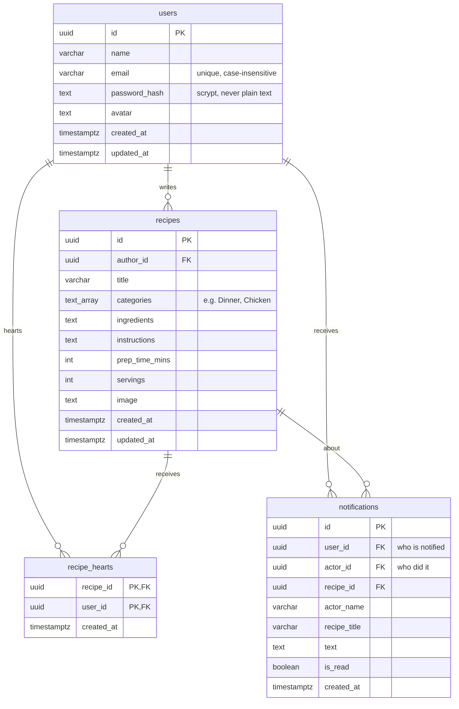

# Cook'N U — Backend and Database

Owner: Backend and Database Engineer. This document covers the three backend
modules, the PostgreSQL schema, the automated tests, and the design decisions
behind them.

## 1. Modules

| Container | Port (internal) | Proxy path | Responsibility |
|---|---|---|---|
| `auth-service` | 3001 | `/api/auth` | Register, login, profile, account deletion. Issues JWT tokens. |
| `recipe-service` | 3002 | `/api/recipes` | Recipe CRUD, search and category filters, hearts, favorites. Creates a notification when someone hearts a recipe. |
| `notification-service` | 3003 | `/api/notifications` | Lists a user's notifications (bell icon) and marks them read. |
| `database` | 5432 | — (not published) | PostgreSQL 17, data in the named volume `postgres-data`. |

All three services are Node.js 22 with **one** runtime dependency (`pg`). HTTP
routing, JWT (HS256) and password hashing (scrypt) use Node's built-in modules.

```
Browser ─► proxy (Nginx :8080)
             ├─ /                  ─► frontend
             ├─ /api/auth          ─► auth-service ───────┐
             ├─ /api/recipes       ─► recipe-service ─────┼─► database (PostgreSQL, volume postgres-data)
             └─ /api/notifications ─► notification-service┘
```

Every service exposes `GET /health` (and `GET <its proxy path>/health`):

```json
{"status":"ok","service":"recipe-service","version":"15","database":"up"}
```

It returns **200** when the service can reach PostgreSQL and **503** when it
cannot. `version` is the Jenkins build number (`BUILD_TAG`), which makes it easy
to prove which build is live during the demo.

## 2. Database schema



The schema and demo data are in [`db/init.sql`](../db/init.sql) and are baked
into the database image ([`db/Dockerfile`](../db/Dockerfile)).

- **Runs once.** PostgreSQL executes init scripts only when the data volume is
  empty. The script is idempotent (`IF NOT EXISTS`, `ON CONFLICT DO NOTHING`).
- **Changing the schema later** does not touch an existing volume. In
  development reset with `docker compose down -v` (this deletes all data). In
  production, add a migration script instead.
- **Demo account:** `chef@cooknu.example` / `Chef@12345`, plus three seed
  recipes (Chicken Adobo, Champorado, Banana Cue).
- **Cascades:** deleting a user deletes their recipes, hearts and notifications;
  deleting a recipe deletes its hearts and notifications.
- **Constraints worth mentioning:** `recipe_hearts` has the primary key
  `(recipe_id, user_id)`, so a user can heart a recipe only once, enforced by the
  database and not just by the code. Prep time and servings have `CHECK > 0`.

## 3. API reference

All bodies are JSON. Protected endpoints need `Authorization: Bearer <token>`.
Errors look like `{"error":"message"}`; validation errors add
`"details":{"field":"reason"}`.

### auth-service

| Method | Path | Auth | Body | Success |
|---|---|---|---|---|
| POST | `/api/auth/register` | — | `name`, `email`, `password` | 201 `{user, token}` |
| POST | `/api/auth/login` | — | `email`, `password` | 200 `{user, token}` |
| GET | `/api/auth/me` | ✔ | — | 200 `{user}` |
| PUT | `/api/auth/me` | ✔ | `name` and/or `avatar` (`null` removes it) | 200 `{user}` |
| DELETE | `/api/auth/me` | ✔ | — | 204 |

Password rules match the sign-up form: at least 6 characters, one capital letter,
one symbol. Errors: 400 validation, 401 bad credentials, 409 email already used.

### recipe-service

| Method | Path | Auth | Notes |
|---|---|---|---|
| GET | `/api/recipes` | optional | Query: `search`, `category` (comma list), `mine=true`, `favorites=true`, `limit` (1–100, default 50), `offset`. Returns `{recipes, limit, offset}`, newest first. `mine` and `favorites` need a token. |
| GET | `/api/recipes/:id` | optional | `{recipe}` |
| POST | `/api/recipes` | ✔ | Only `title` is required. 201 `{recipe}` |
| PUT | `/api/recipes/:id` | ✔ owner | Same body as POST. Omitting `image` keeps the old one; `""` clears it. |
| DELETE | `/api/recipes/:id` | ✔ owner | 204 |
| POST | `/api/recipes/:id/heart` | ✔ | Toggles. Returns `{hearted, hearts, recipe}`. Notifies the author (not for your own recipes). |

Recipe fields: `title`, `category` (`"Dinner,Chicken"`) or `categories`
(`["Dinner","Chicken"]`), `ingredients`, `instructions`, `prepTime` (`30` or
`"30 mins"`), `servings`, `image` (image data-URL or http(s) URL, max 400 KB).
Allowed categories: Breakfast, Lunch, Dinner, Snacks, Dessert, Drinks, Chicken,
Beef, Seafood, Vegetarian. Responses include `hearts`, `heartedByMe`, and
`author {id, name, avatar}`. Errors: 401, 403 (not the owner), 404.

### notification-service

| Method | Path | Auth | Success |
|---|---|---|---|
| GET | `/api/notifications?limit=20` | ✔ | 200 `{notifications:[{id,text,actorName,recipeId,recipeTitle,read,createdAt}], unread}` |
| POST | `/api/notifications/read-all` | ✔ | 200 `{updated}` |

## 4. Mapping from the current frontend (Firebase) to the API

The frontend (`frontend/app.js`) still talks to Firebase. To make the app use
the backend and database, replace these calls:

| Frontend code today | Replace with |
|---|---|
| `createUserWithEmailAndPassword` + `setDoc(users/…)` | `POST /api/auth/register` (keep the EmailJS OTP step before it) |
| `signInWithEmailAndPassword` | `POST /api/auth/login`, keep `token` in `localStorage` |
| `onAuthStateChanged` | on page load: `GET /api/auth/me` with the stored token |
| `signOut` | delete the stored token |
| `updateDoc(users/…)`, profile edit | `PUT /api/auth/me` |
| `onSnapshot(recipes)` | `GET /api/recipes` (re-fetch after changes) |
| `addDoc(recipes, …)` / `updateDoc` / `deleteDoc` | `POST` / `PUT` / `DELETE /api/recipes[/:id]` |
| `hearts_by` + `arrayUnion/arrayRemove` | `POST /api/recipes/:id/heart` (`recipe.heartedByMe`, `recipe.hearts`) |
| favorites tab | `GET /api/recipes?favorites=true` |
| My recipes tab | `GET /api/recipes?mine=true` |
| `addNotification` / reading `notifications` | server creates them on heart; read with `GET /api/notifications` |

Call the API with relative URLs (`fetch('/api/recipes')`). The proxy serves both
the site and the API from the same origin, so no CORS setup is needed.

## 5. Tests

Each service has unit tests using Node's built-in runner (`node --test`), with
no extra test libraries. The tests start the real HTTP server on a random port
and call it with `fetch`; only the database is replaced by an in-memory
repository (`tests/memory-repo.js`).

| Service | Tests | What they cover |
|---|---|---|
| auth-service | 27 | health (ok / 503), registration rules, duplicate email, hashing, login, wrong-password vs unknown-email, JWT forgery / expiry / `alg` attacks, profile update, account deletion, no hash in any response |
| recipe-service | 40 | validation, create/read/update/delete, ownership (403), search, category filter, paging, hearts toggle, notifications (once, never for self), favorites, JWT |
| notification-service | 15 | auth required, per-user isolation, unread count, mark-all-read, limit validation, JWT |

Run locally (Node 22+, no install needed for the tests):

```bash
cd recipe-service && npm test
```

Run the way Jenkins does (inside Docker). A failure fails the build, which stops
the pipeline before Deploy:

```bash
docker build --target test -t cooknu-recipe-service:test ./recipe-service
```

The SQL itself is not exercised by the unit tests. It is verified after every
deployment by [`scripts/smoke-test.sh`](../scripts/smoke-test.sh), which runs
register → login → create → search → heart → notification → cleanup through the
proxy against the real database.

```bash
BASE_URL=http://localhost:8080 sh scripts/smoke-test.sh
```

## 6. Design decisions (for the technical documentation and Q&A)

- **Why PostgreSQL?** The data is relational (users ↔ recipes ↔ hearts) and needs
  constraints, such as unique emails and one heart per user per recipe, and
  cascading deletes. These are enforced by the database even if application code
  has a bug.
- **Why hearts as a table instead of an array?** Firestore stored `hearts_by` as
  an array. A join table with a composite primary key prevents duplicates, makes
  "my favorites" a simple indexed query, and avoids a drifting counter: the count
  is computed from the rows.
- **Why separate services sharing one database?** It keeps each module small and
  independently built, tested and containerized. Sharing one database is a
  deliberate simplification for this course project. A production system would
  give each service its own schema or database user, or call the other services
  through an API.
- **Why no web framework and no `jsonwebtoken` / `bcrypt` packages?** Fewer
  dependencies means smaller images, no native modules to compile on Alpine, a
  smaller attack surface, and tests that run with no installation. The tradeoff
  is that we maintain ~100 lines of JWT/router code ourselves; the JWT code is
  covered by tests for tampering, expiry and algorithm confusion.
- **Password storage:** scrypt with a random 16-byte salt per password and a
  constant-time comparison. Login for an unknown email still performs a hash
  comparison so response time does not reveal which emails are registered.
- **Stateless auth:** the token (JWT, 7 days) is verified by every service using
  the shared `JWT_SECRET`, so the services never call each other. Because a token
  stays valid until it expires, the services re-check that the user still exists
  on sensitive operations.
- **SQL injection:** every query is parameterized (`$1, $2, …`). Search text is
  also escaped for `LIKE` wildcards, and ids are validated as UUIDs before use.
- **Health endpoint:** checks the database with `SELECT 1`, so Docker's
  `HEALTHCHECK` and `depends_on: service_healthy` reflect real readiness, not
  just "the process started".
- **Graceful shutdown:** services handle `SIGTERM` (sent by `docker compose up`
  on redeploy) by finishing in-flight requests and closing the DB pool.
- **Persistence:** the database lives in the named volume `postgres-data`. A
  redeploy replaces containers but not the volume, so records survive. Only
  `docker compose down -v` deletes it.

## 7. Known limitations

- Image uploads are stored in the database as data-URLs (the frontend compresses
  them to ~200 KB). A real system would use object storage such as MinIO.
- The email OTP step happens in the browser (EmailJS), so it is not enforced by
  the server. Server-side email verification would be the next step.
- No rate limiting on login. A reverse-proxy `limit_req` rule would be a cheap
  improvement.
